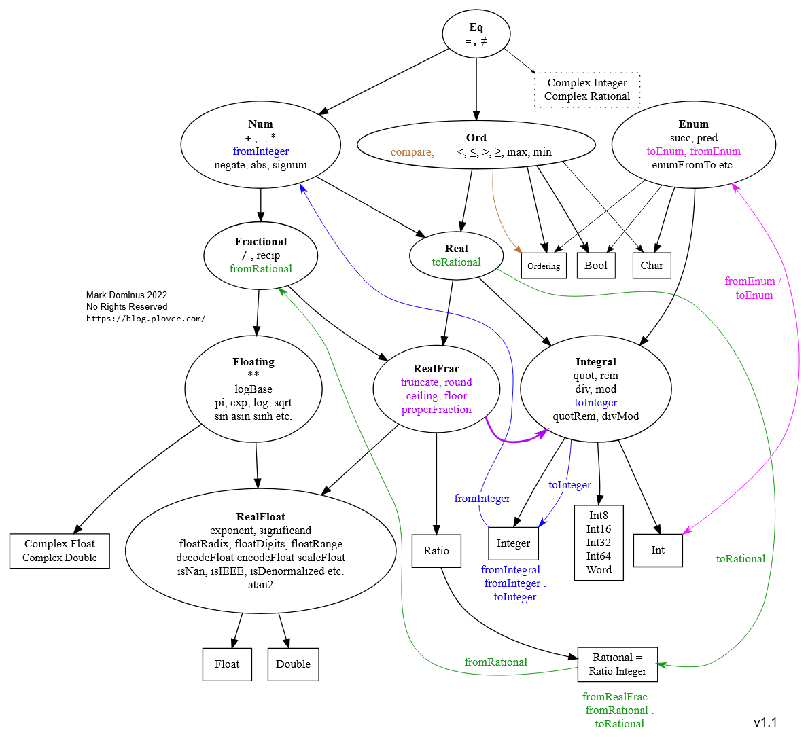

# Instalação

```
Set-ExecutionPolicy Bypass -Scope Process -Force;[System.Net.ServicePointManager]::SecurityProtocol = [System.Net.ServicePointManager]::SecurityProtocol -bor 3072; try { & ([ScriptBlock]::Create((Invoke-WebRequest https://www.haskell.org/ghcup/sh/bootstrap-haskell.ps1 -UseBasicParsing))) -Interactive -DisableCurl } catch { Write-Error $_ }
```


- haskell-language-server: ferramenta de ajudas (autocomplete) → sim


**Manual**: https://learnyouahaskell.github.io/chapters.html


# Hello World

````
ghc --version
````

The Glorious Glasgow Haskell Compilation System, version 8.10.7

````
ghci
````
````
main = putStrLn "Hello, Haskell!"
````
GHCi, version 9.10.3: https://www.haskell.org/ghc/  :? for help


ou


Crie ``teste.hs`` 

````
main :: IO ()
main = putStrLn "Hello, Haskell!"
````

Rode 
````
runghc teste.hs
````


# Haskell

Nessa linguagem tudo é uma função que retorna um valor. A estrutura é:

``função var1 var2``

Ex.: ``sum 1 2``


# Função
Dá para definir uma função como:

``nome var = operação``

Exemplo:

``doubleMe x = x + x  ``

E depois chamar como:

````
doubleMe 9 
18
````

Outro exemplo:
```
doubleUs x y = x*2 + y*2

doubleUs 4 9
26
```


## Definição ou Nome

Variável (ou constante) também é uma função, mas que não recebe parâmetro, só retorna o que foi definido.

````
valor = 5

conanO'Brien = "It's a-me, Conan O'Brien!"  
````

### Tudo é uma função

`x = 5`

- `5`: Uma função que não recebe parâmetros e o valor 5; 
- `=`: Uma função que recebe `x` e `5` e atribui o valor de 5 em `x`;
- `x`: uma função que agora vai retornar o valor 5.


## If / Else
```
doubleSmallNumber x = if x <= 100  
                        then x*2  
                        else x  
```
ou
```
doubleSmallNumber' x = (if x > 100 then x else x*2) + 1  
```


# Tipagem

Estática e Forte.
Tem inferência.

## Tipos

- **Int**: Inteiro de tamanho fixo (limitado pela arquitetura do seu processador, geralmente 32 ou 64 bits).

- **Integer**: Inteiro de precisão arbitrária (pode crescer o quanto a memória do computador permitir para suportar números gigantescos).

- **Float**: Precisão simples.

- **Double**: Precisão dupla (o mais recomendado e usado para decimais).

- **Bool**: Valores booleanos (True ou False).

- **Char**: Caracteres individuais, representados entre aspas simples (ex: 'a', 'Z', '1').

- **String**: Textos. Uma lista de Char, e são escritas entre aspas duplas (ex: "Olá, mundo").

- **Listas** ([a]): Coleções ordenadas de elementos do mesmo tipo (ex: [1, 2, 3] ou ["maçã"] = ['m', 'a', 'ç', 'ã']).

- **Tuplas** ((a, b)): Agrupamentos de valores que podem ser de tipos diferentes (ex: ("Idade", 25)).


```
ghci> :t 'a'  
'a' :: Char

ghci> :t True  
True :: Bool

ghci> :t "HELLO!"  
"HELLO!" :: [Char]

ghci> :t (True, 'a')  
(True, 'a') :: (Bool, Char)

ghci> :t 4 == 5  
4 == 5 :: Bool  
```


## Classes dos Tipos

Cada tipo faz parte de uma classe, exemplo, os Int fazem parte da Classe Ord, o que signfica que eles podem ser ordenados.

- show: valores que podem ser Strings
```
ghci> show 5.334  
"5.334"  

ghci> show True  
"True"  
```

- read: valores em Strings que podem ser inferidos.

```
ghci> read "True" || False  
True  

ghci> read "8.2" + 3.8  
12.0  

ghci> read "5" - 2  
3  

ghci> read "[1,2,3,4]" ++ [3]  
[1,2,3,4,3]  
```




## Conversão

Para converter tem que criar outra variável.
````
let soma = num1 + num2
let somaStr = show soma
````

## Tipagem de funções
````
doubleMe :: Int -> Int
doubleMe x = x + x 
````
````
addThree :: Int -> Int -> Int -> Int  
addThree x y z = x + y + z  
````
